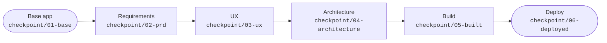

<div align="center">

<picture>
  <source media="(prefers-color-scheme: dark)" srcset="public/logo/checkinn-logo-on-dark.webp">
  <source media="(prefers-color-scheme: light)" srcset="public/logo/checkinn-logo-on-light.webp">
  
</picture>

<p><strong>Hotel booking with a short path from "I need somewhere to stay" to a confirmed stay.</strong></p>

[](https://github.com/Dynamic-Visual-Technologies-PTY-LTD/checkinn/actions/workflows/ci.yml)
[](LICENSE)
[](.nvmrc)
[](https://nextjs.org)
[](https://react.dev)
[](tsconfig.json)
[](https://tailwindcss.com)
[](vitest.config.mts)
[](playwright.config.ts)

[Quick start](#quick-start) · [Scripts](#scripts) · [Stack](#stack) · [The workshop](#the-workshop) · [Repository map](#repository-map) · [Contributing](#contributing)

</div>

> [!NOTE]
> **Status: project shell.** The app is a placeholder home page. The booking system itself has not been built yet.

## What it is

CheckInn is a simple hotel-booking web application: a guest searches for a hotel, views it, and books a stay. Finding the right hotel should not take a dozen filters, so the path from search to booking is kept short.

The planned enhancement is **intelligent search**. A guest describes what they want in plain language and the results are ranked by how well they match.

CheckInn is also the demo application for DVT's AI-DLC workshop at AI Expo Africa 2026, where that enhancement is built live. See [The workshop](#the-workshop).

## Quick start

You need Node.js 24 (see [`.nvmrc`](.nvmrc)). No database, API keys or other services are required.

```bash
npm install
npm run dev
```

Then open http://localhost:3000.

## Data

The catalog lives in a SQLite file, `data/checkinn.db`, which is not committed. The app creates it on the first request, applies the migrations in [`drizzle/`](drizzle) and loads the seed. Set `CHECKINN_DB_PATH` to put the file somewhere else. To start again from the seed, run `npm run db:reset`. It empties every table and loads the seed again in one transaction, without deleting the file, so the app can keep running and shows the reset data on its next request.

The committed seed, [`data/seed/hotel-booking-demo.json`](data/seed/hotel-booking-demo.json), contains **120 fictional hotels, 348 room types and 20 South African destinations**. Hotels, reviews and prices are fictional demo content. The original 12 hotels and six cities are preserved, with new records appended; ids are the primary keys. To reproduce the appended records, run `node scripts/expand-demo-catalog.mjs`.

Existing databases are never automatically reseeded: reopening the app preserves their catalog and bookings. To load the expanded catalog into an existing installation, back up any bookings you need, then explicitly run `npm run db:reset`. **Reset erases all bookings and booking lines**, as well as replacing the catalog. A fresh installation loads the expanded seed automatically.

Ordinary search matches hotel names, areas, cities, city aliases and provinces. It does not search descriptions semantically; embedding-based relevance remains planned work. It maps to the tables like this:

| Seed | Table | Notes |
|---|---|---|
| `cities[]` | `cities` | `image.*` becomes `image_*` columns; `sort_order` is the position in the seed |
| `hotels[]` | `hotels` | `priceFromPerNight` becomes `price_from_per_night_rand`; `amenities` and `policies` are JSON text |
| `hotels[].images[]` | `hotel_images` | Keyed by `hotel_id` and `position` in the array |
| `hotels[].roomTypes[]` | `room_types` | `pricePerNight` becomes `price_per_night_rand`; `beds` and `amenities` are JSON text |

`amenityLabels` and `metadata` are not stored. Original destination and hotel photos load from Wikimedia Commons and Unsplash; when they can't, a placeholder shows instead. New properties reuse existing illustrative stock photos with their source and licence credits. The 14 added destinations use distinct local AI-generated landscape illustrations under `public/images/destinations/`, so those tiles work without external image requests. The second gallery image for each added property is a local AI-generated room illustration selected to match its room category; the images and prompts live under `public/images/rooms/` and `data/seed/room-images.json`. Credits make clear that the generated scenes are illustrative, not verified depictions of a real property. Hotel photos do not depict the fictional properties.

## Scripts

| Command | What it does |
|---|---|
| `npm run dev` | Start the dev server |
| `npm run lint` | ESLint |
| `npm run typecheck` | Generate Next.js route types, then run the TypeScript check |
| `npm test` | Unit and component tests (Vitest) |
| `npm run test:watch` | The same tests in watch mode |
| `npm run test:e2e` | End-to-end tests in a real browser (Playwright) |
| `npm run test:e2e:ui` | The same tests in Playwright's interactive UI |
| `npm run design:lint` | Validate the design tokens in `DESIGN.md` |
| `npm run db:generate` | Generate a migration in `drizzle/` after changing `src/db/schema.ts` |
| `npm run db:reset` | Reset the database to the seed; safe while the app runs |
| `npm run build` | Production build |
| `npm start` | Serve the production build |

<details>
<summary><strong>Running the end-to-end tests</strong></summary>

<br>

The end-to-end tests need a browser, downloaded once:

```bash
npx playwright install chromium
```

They build the app and start their own production server on port 3100, against a temporary database that is reset before each run. A dev server on port 3000 and `data/checkinn.db` are left alone. They run against a desktop viewport only.

</details>

<details>
<summary><strong>Using VS Code</strong></summary>

<br>

The same commands are available under **Tasks: Run Task**. The `verify` task runs lint, typecheck, test and build in sequence.

The Run and Debug panel has configurations for debugging the server, the browser, both together, and the current test file.

</details>

## Running at the expo

On the presenter laptop, serve a production build to the whole network, so the projector and visitors' phones use one running app over plain HTTP:

```bash
npm run build
npm start -- -H 0.0.0.0
```

Phones open `http://<laptop-ip>:3000` on the same Wi-Fi. Between sessions, run `npm run db:reset` in a second terminal; it is safe while the app runs. After a crash, run `npm start -- -H 0.0.0.0` again; Bookings are kept.

The full steps, with the firewall, the checks for the projector and each phone, and recovery, are in the [expo dry-run checklist](_bmad-output/initiative-checkinn-mvp/epic-checkinn-mvp/expo-dry-run-checklist.md).

## Stack

| Area | Choice |
|---|---|
| Runtime | Node.js 24 |
| Language | TypeScript, `strict` |
| Framework | Next.js 16, App Router, Turbopack |
| UI | React 19 |
| Styling | Tailwind CSS 4 |
| Unit and component tests | Vitest, Testing Library, jsdom |
| End-to-end tests | Playwright, Chromium |
| Linting | ESLint with `eslint-config-next` |
| Database | SQLite, embedded in the app |
| Data access | Drizzle ORM with `better-sqlite3` |
| CI | GitHub Actions |

It is one full-stack Next.js app. There is no separate API service.

<details>
<summary><strong>Agreed, not installed yet</strong></summary>

<br>

| Area | Choice |
|---|---|
| Vector search | `sqlite-vec`, for the search enhancement |
| Hosting | Azure |
| Infrastructure as code | Bicep or Terraform, undecided |

</details>

## The workshop

The AI Expo Africa 2026 session takes this system and runs one enhancement, intelligent search, through the AI-DLC, which brings spec-driven development (SDD) and AI-native ways of working together. Each stage is handed from one role to the next, and each ends with a git tag so the presenters can jump to a known-good state.



None of the checkpoint tags exist yet. They are created as each stage is rehearsed.

The agenda, roles and open items are in [docs/workshop](docs/workshop/README.md).

## Repository map

| Path | Contents |
|---|---|
| [`src/app/`](src/app) | The Next.js application, with unit tests beside the code |
| [`e2e/`](e2e) | End-to-end tests (Playwright) |
| [`public/logo/`](public/logo) | The CheckInn wordmark and icon |
| [`DESIGN.md`](DESIGN.md) | Visual identity: design tokens and usage rules |
| [`docs/workshop/`](docs/workshop/README.md) | Workshop agenda, roles and checkpoints |
| [`infra/`](infra/README.md) | Infrastructure as code (placeholder) |
| `_bmad/`, `.claude/skills/`, `.agents/skills/` | [BMAD Method](https://github.com/bmad-code-org/BMAD-METHOD) configuration and skills |
| [`AGENTS.md`](AGENTS.md) | Instructions for AI coding agents working in this repo |

## Working with the AI agents

The repo is set up for [Claude Code](https://claude.com/claude-code) with the BMAD Method skills installed. BMAD's scripts need [uv](https://docs.astral.sh/uv/). Open the repo in Claude Code and ask `bmad` what to do next.

[`AGENTS.md`](AGENTS.md) holds the conventions the agents follow: the stack, the commands, and what needs asking first.

## Contributing

Branch from `main`, keep a pull request to one change, and make sure lint, typecheck, tests and build pass. The details are in [CONTRIBUTING.md](.github/CONTRIBUTING.md).

## License

Released under the [MIT License](LICENSE).

<br>

<div align="center">
  
  <br>
  <sub>Built by DVT for AI Expo Africa 2026.</sub>
</div>
