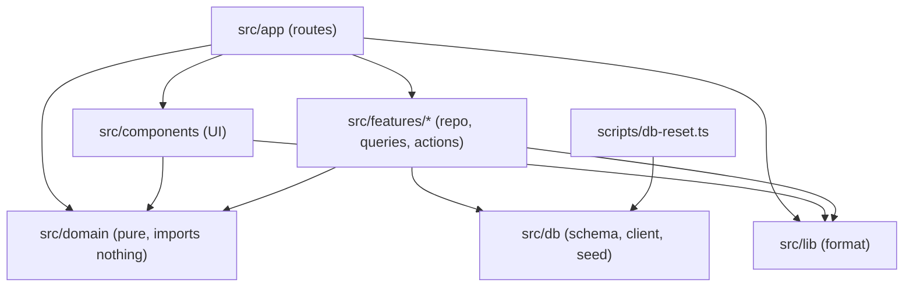
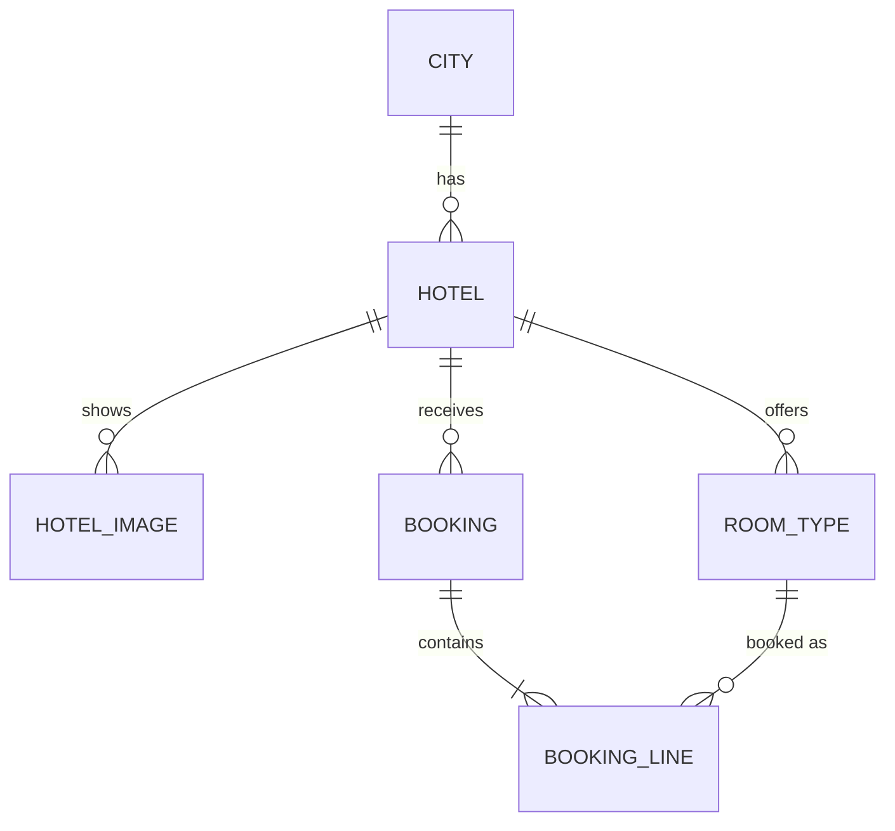
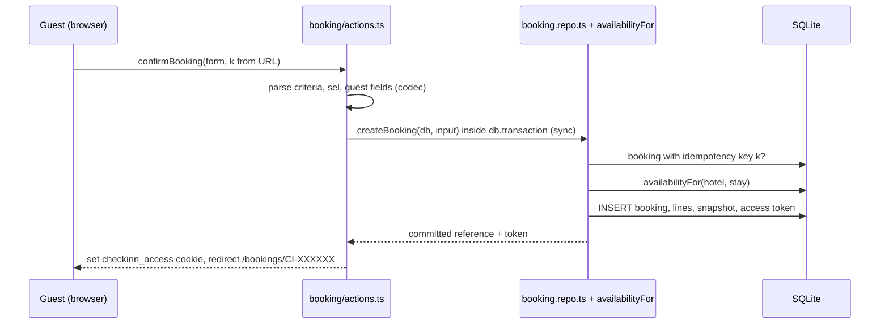
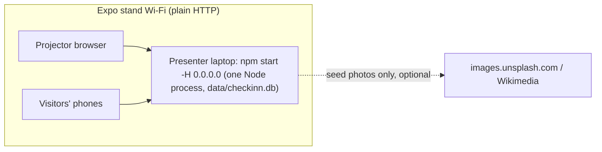

# Architecture Spine — CheckInn MVP

## Design Paradigm

**Layered**, inside one Next.js App Router app. Each layer depends only on the layers below it.

| Layer | Lives in | Holds |
| --- | --- | --- |
| Presentation | `src/app/`, `src/components/` | Routes, layouts, server components, client components |
| Application | `src/features/{search,hotels,booking}/` | `*.repo.ts`: synchronous functions that take `db`. `queries.ts`: request-time read wrappers. `actions.ts`: server actions. Only this layer and `src/db` touch the database. |
| Domain | `src/domain/` | Pure TypeScript: view-model types, criteria codec, search rules, availability counting, pricing, cancellation, references, clock |
| Data | `src/db/` | Drizzle schema, connection, migrations, seed and reset |



## Invariants & Rules

### AD-1 — Layered dependency rule [ADOPTED]

- **Binds:** all
- **Prevents:** UI reading the database directly; domain logic tied to Next.js or Drizzle, so it can't be unit tested or replaced; scripts and tests unable to import the data layer.
- **Rule:**
  - Follow the dependency diagram above.
  - `src/domain` imports nothing from `src/app`, `src/features`, `src/db`, `next` or `react`.
  - `src/components` and every `"use client"` file never import `src/db`, `*.repo.ts`, `queries.ts` or `actions.ts` module internals. They may import server actions only as functions.
  - `import "server-only"` appears only in `queries.ts` and `actions.ts`. `src/db` and `*.repo.ts` stay free of it, so `tsx` scripts and Vitest can load them. Next resolves `server-only` without installing it.

### AD-2 — Request-time reads in server rendering

- **Binds:** FR-1–FR-8, FR-16–FR-18, FR-21–FR-24, FR-27
- **Prevents:** `cacheComponents` prerendering a synchronous `better-sqlite3` query, `new Date()` or `crypto.randomUUID()` at build time. That would freeze availability, Bookings, default dates or ids into static HTML, or make the build need a database.
- **Rule:**
  - Before its first query, clock read or random value, every exported function in `src/features/*/queries.ts` calls `await io()` (from `next/cache`). So does any server component that reads the clock.
  - Data-dependent UI renders inside `<Suspense>` with the EXPERIENCE.md skeleton states.
  - Nothing that reads the database, the clock or random values uses `"use cache"`.
  - Server actions run at request time and need no `io()`.

### AD-3 — One write path for Bookings

- **Binds:** FR-22, FR-24, PRD §5 reliability
- **Prevents:** overselling a Room when several expo visitors confirm at once, and two code paths that write Bookings differently.
- **Rule:**
  - Creating and cancelling a Booking happen only in `src/features/booking/actions.ts`, through `src/features/booking/booking.repo.ts`.
  - Each write is one synchronous `db.transaction(...)`, with no `await` and no promise inside it.
  - Creating: look up the idempotency key (AD-10). Re-compute Availability with `availabilityFor` (AD-4) for every Booking line, then insert the Booking, its lines and its snapshot (AD-16). If any line no longer fits, insert nothing.
  - Cancelling: re-check the snapshot's Cancellation policy and deadline (AD-9), then set the status.
  - No route handler, script or other module writes `bookings` or `booking_lines`. The one exception is the reset (AD-6).
  - `redirect()` runs after the transaction commits, outside any `try`.

### AD-4 — Availability: one synchronous core, derived never stored

- **Binds:** FR-5, FR-6, FR-17, FR-18, FR-22
- **Prevents:** search, the room table and confirm each meaning something different by "available"; a stored counter drifting from the Bookings; an async availability check that can't run inside the write transaction.
- **Rule:**
  - `availabilityFor(db, hotelId, stay): Map<roomTypeId, number>` in `src/features/hotels/availability.repo.ts` is the only Availability computation. It is synchronous.
  - Its SQL selects only Confirmed Booking lines whose Stay overlaps (`check_in < :checkOut AND check_out > :checkIn`). `countAvailable` in `src/domain/availability.ts` then takes `totalRooms` minus the busiest Night of the Stay, where a Booking covers a Night when check-in ≤ Night < check-out.
  - A Room type is **available** when its count is at least 1. Search (FR-5), the Listing card "from" price (FR-6), the room table (FR-17) and confirm (FR-22) all use this function.
  - `src/features/booking` may import this one file from `src/features/hotels`.
  - Pages call it through an async wrapper in `src/features/hotels/queries.ts` (AD-2).

### AD-5 — Ownership of shared data

- **Binds:** FR-25, FR-26, all reads
- **Prevents:** runtime code editing catalog data, and two features each owning Bookings.
- **Rule:**
  - The catalog tables (`cities`, `hotels`, `hotel_images`, `room_types`) are written only by `src/db/seed.ts`.
  - The `bookings` and `booking_lines` tables are owned by `src/features/booking`. Other features read them only through `availabilityFor` (AD-4).

### AD-6 — The seed file is the source of catalog truth; reset is transactional

- **Binds:** FR-25, FR-26, PRD §5 fresh clone, expo reset
- **Prevents:** catalog values copied into code or migrations; a fresh clone that needs manual setup; a reset that fails on Windows (`EBUSY` on an open file) or leaves the running server showing old Bookings.
- **Rule:**
  - The seed is committed unchanged at `data/seed/hotel-booking-demo.json`. Its ids (cities `cape-town`; hotels `hotel-001`…; Room types `hotel-001-standard`…) are the catalog primary keys, and the database stores its prices, scores and policies as-is.
  - On first database access, `src/db/client.ts` applies the committed migrations, then seeds if `hotels` is empty.
  - `npm run db:reset` opens the same file and, in one transaction, deletes all rows from every table and re-inserts the seed. It never deletes the file. It is safe while the server runs.

### AD-7 — Search is one replaceable function

- **Binds:** FR-2, FR-3, FR-5, FR-6, FR-7, FR-8, FR-27, PRD §5 workshop-ready
- **Prevents:** search rules scattered across pages, which would make the later intelligent-search work a rewrite.
- **Rule:**
  - `searchHotels(criteria: SearchCriteria): Promise<SearchResult>` in `src/features/search/queries.ts` is the only entry point for listing Hotels. A City tile's link runs it with the City name as the query and the current criteria. The Hotel count shown on a tile is a plain catalog count, not a search.
  - It loads the catalog and `availabilityFor` per Hotel, then applies the pure rules in `src/domain/search.ts` (matching FR-3, filtering FR-5, ranking and heading FR-7).
  - `SearchCriteria`, `SearchResult` and `ListingCard` are defined in `src/domain/types.ts`. A replacement keeps the signature and these types.

### AD-8 — The URL holds the criteria, through one codec

- **Binds:** FR-1, FR-4, FR-16, FR-18, FR-21; EXPERIENCE stale-link, no-dates, room-ran-out and cancelled states
- **Prevents:** pages and actions parsing query strings differently; stale links behaving differently per page; a selection that mixes Hotels.
- **Rule:**
  - `src/domain/criteria.ts` alone parses and serializes the parameters `q`, `checkIn`, `checkOut`, `adults`, `children`, `rooms`, `hotel`, `sel`, `k` and `notice`.
  - Parsing returns the criteria with `stay: Stay | null` and a list of problems.
  - What happens when `stay` is null:

    | Case | Home and `/search` | Hotel page | `/book` |
    | --- | --- | --- | --- |
    | Dates absent | Today + 1 for 1 night (AD-9) | Stays null: the no-dates state (FR-16) | — |
    | Dates past, malformed or over the limits | Null, with a problem: show the stale-link state and run no search | Null, with a problem: stale-link state | Redirect to the Hotel page |

  - `sel` has the form `roomTypeId:qty,…`. It is valid only when every Room type belongs to `hotel` and every quantity is a positive integer. Otherwise `/book` redirects to the Hotel page.
  - `notice` takes `room-unavailable` (with `rt`, the Room type ids that ran out) or `cancelled`.
  - Server actions re-parse their input with this codec and never trust client values.

### AD-9 — Dates, time and money

- **Binds:** FR-1, FR-6, FR-19, FR-20, FR-21, FR-24
- **Prevents:** time-zone bugs in Night counts and deadlines; float rounding; inconsistent rand formatting across the card, table, summary and confirmation (SM-4).
- **Rule:**
  - Stay dates are ISO calendar strings (`YYYY-MM-DD`) with no time and no time zone.
  - "Today" and "now" come only from `src/domain/clock.ts`, in `Africa/Johannesburg`. On the server the clock is read only after `io()` (AD-2), and tests inject it.
  - The cancellation deadline is the check-in date at the Hotel's `checkInTime`, in `Africa/Johannesburg`, minus 48 hours. It is stored as an ISO UTC timestamp.
  - Money is an integer number of whole rand, in fields named `…Rand`. Totals are computed only in `src/domain/pricing.ts`.
  - Display goes only through `formatZar(amount, { cents })` in `src/lib/format.ts`, using `Intl` `en-ZA`.

### AD-10 — Booking identity, idempotency and normalisation

- **Binds:** FR-21, FR-22, FR-23; UX reference format
- **Prevents:** duplicate Bookings from a double click, a refresh, or Back followed by confirming again; references stored in one form and looked up in another; email mismatches caused by case.
- **Rule:**
  - Reserve calls the `startBooking` server action. It validates the selection, mints the `idempotencyKey` (UUID) on the server, and redirects to `/book?hotel=…&<criteria>&sel=…&k=…`.
  - `k` is stored `UNIQUE` on the Booking. Confirming with a key already used redirects to that Booking.
  - References are generated by `src/domain/reference.ts`: `CI-` plus 6 characters from `ABCDEFGHJKMNPQRSTUVWXYZ23456789`. They are stored uppercase with the prefix and `UNIQUE`; generation retries on a collision.
  - All input passes through `normaliseReference`, which trims, uppercases and adds `CI-` if missing.
  - Email is stored and compared trimmed and lowercased.

### AD-11 — Server action result contract

- **Binds:** FR-21–FR-24; EXPERIENCE State Patterns
- **Prevents:** each form inventing its own error shape; expected outcomes surfacing as crashes; a server error wiping what the guest typed.
- **Rule:**
  - Success always ends in `redirect()`.
  - Expected failures that keep the guest on the form return `{ ok: false, code, fieldErrors?, message }`. `code` is one of `VALIDATION`, `NOT_FOUND`, `NOT_CANCELLABLE`, `DEADLINE_PASSED`, `ALREADY_CANCELLED` and `SERVER_ERROR`.
  - A Room type running out redirects to the Hotel page with the criteria, `sel`, `notice=room-unavailable` and `rt`.
  - A successful cancel redirects to the Booking view with `notice=cancelled`.
  - Actions catch unexpected errors, log them (without personal data), and return `SERVER_ERROR`, so the form keeps its values.
  - Rendering errors go to the route's `error.tsx`.

### AD-12 — Database process model

- **Binds:** PRD §5, §7.2; expo deployment
- **Prevents:** extra long-lived writers on one SQLite file; a new connection per request or per hot reload.
- **Rule:**
  - One Node process serves the app. The only other connection allowed is the short-lived `db:reset` (AD-6).
  - `src/db/client.ts` exports one `better-sqlite3` connection per process, kept on `globalThis` in development. It runs with `journal_mode = WAL`, `foreign_keys = ON` and `busy_timeout = 5000`.
  - The file path comes from `CHECKINN_DB_PATH`, default `data/checkinn.db`. That file is gitignored and never committed.
  - Never run the app as several processes or serverless functions against one file.

### AD-13 — Client components never touch data and work over plain HTTP

- **Binds:** FR-1, FR-9–FR-11, FR-16, FR-18, FR-21–FR-24
- **Prevents:** data access or rules leaking into the browser; client state drifting from the URL; features that work on `localhost` but fail on visitors' phones over `http://<laptop-ip>`, which is not a secure context.
- **Rule:**
  - `"use client"` only where a component needs state, effects or browser APIs (AGENTS.md), and for `error.tsx`.
  - Client components receive serializable view models from `src/domain/types.ts`. They change criteria by navigating to a URL built with the criteria codec (AD-8), and write data only through server actions.
  - Browser APIs that need a secure context are never required:
    - Clipboard use falls back to the select-and-copy dialog in EXPERIENCE.md.
    - Ids are minted on the server, never with `crypto.randomUUID()` in the browser.
  - Save (heart) state lives in `localStorage` under one key, `checkinn:saved`.

### AD-14 — One component renders remote photos

- **Binds:** FR-10, FR-11, FR-27
- **Prevents:** inconsistent fallbacks; a `next/image` remote-host config change (an ask-first item); server-side image fetches that fail with no internet.
- **Rule:**
  - Every seed photo (hotel and city) renders through `src/components/remote-image.tsx`. It renders a plain `` with the seed alt text and swaps to the image placeholder on `error`. The `no-img-element` warning is disabled in that file only.
  - City photos always render their credit line.

### AD-15 — Booking access without email in URLs

- **Binds:** FR-22, FR-23, FR-24
- **Prevents:** the confirmation page refusing the guest who just booked; guest email in URLs, history and logs; anyone holding a reference being able to cancel.
- **Rule:**
  - Each Booking has a random `access_token` (minted on the server).
  - Confirming, and a successful reference + email lookup on `/manage`, add the token to the `checkinn_access` cookie: httpOnly, `SameSite=Lax`, `Path=/`, not `Secure` because the stand serves plain HTTP. The cookie holds at most 20 tokens and lasts 30 days.
  - `/bookings/[reference]` and the cancel action require a matching token in that cookie. Without one, they redirect to `/manage?reference=…`.
  - Email never appears in a URL.

### AD-16 — A Booking stores a snapshot

- **Binds:** FR-20, FR-22–FR-24
- **Prevents:** confirmation, Booking view and cancel recomputing prices or policies from the catalog, and disagreeing with what the guest confirmed.
- **Rule:**
  - At confirm, the Booking stores, in the same transaction:
    - the Stay
    - the Party
    - per line: `unitPriceRand`, `quantity` and `lineTotalRand`
    - `bookingTotalRand` and `cancellationPolicy`
    - `cancellationDeadline` (null for Non-refundable)
  - Every Booking view and the cancel rule read the snapshot only.

### AD-17 — Nothing loads from the network except seed photos

- **Binds:** PRD §5 fresh clone and offline, FR-11
- **Prevents:** a fresh clone or the stand failing without internet because of a font or other asset fetch.
- **Rule:**
  - Poppins loads through `next/font/local` from OFL font files committed under `src/app/fonts/`. This replaces the current `next/font/google` in `src/app/layout.tsx`.
  - Icons are inline SVG. No CDN, analytics or remote script.
  - The only runtime network requests are seed photo URLs (AD-14).

### AD-18 — Environments and test isolation

- **Binds:** PRD §5, AGENTS.md testing rules
- **Prevents:** tests writing to the developer's database; parallel e2e specs racing over the same Rooms; tests that can't load the data layer.
- **Rule:**

  | Environment | Database | How |
  | --- | --- | --- |
  | Dev | `data/checkinn.db` | `npm run dev` |
  | Unit | `:memory:`, migrated and seeded per test file | Vitest. Repo and domain tests use `// @vitest-environment node`; component tests stay on jsdom. |
  | E2E | a temporary file | Playwright `webServer.env.CHECKINN_DB_PATH` (never reusing the dev server) and a reset in global setup. Specs that create or cancel Bookings run serially, in one project, with unique guest emails. |
  | Expo | `data/checkinn.db` on the presenter laptop | `npm run build && npm start -- -H 0.0.0.0`. Run `npm run db:reset` between sessions; restart with `npm start` after a crash (data persists). |



## Consistency Conventions

| Concern | Convention |
| --- | --- |
| File names | kebab-case (`remote-image.tsx`, `availability.repo.ts`); React components PascalCase exports; route files per App Router names |
| Imports | `@/` alias only (AGENTS.md) |
| Entity names | PRD Glossary terms in code: `Hotel`, `RoomType`, `Stay`, `Party`, `Booking`, `BookingLine`, `bookingTotalRand` |
| View models | Defined once in `src/domain/types.ts`; built in `*.repo.ts` or `queries.ts`; plain serializable objects |
| Tables | snake_case plural (`room_types`, `booking_lines`), snake_case columns, mapped to camelCase by Drizzle |
| Ids | Catalog: seed string ids. Bookings: integer primary key internally; only the Booking reference appears in UI and URLs |
| Booking status | `confirmed` or `cancelled`; `created_at` and `cancelled_at` as ISO UTC |
| Routes | `/`, `/search`, `/hotels/[hotelId]`, `/book`, `/bookings/[reference]` (confirmation and Booking view), `/manage`, `/credits` (photo credits from the seed) |
| Page titles | "{context} · CheckInn" (EXPERIENCE.md) |
| Errors | AD-11; messages from the EXPERIENCE.md voice table |
| Logging | `console.error` on the server for unexpected errors only. Never log email, phone, name or access tokens |
| Config | `CHECKINN_DB_PATH` is the only environment variable; no `.env` committed |
| Scripts | `db:reset` runs `tsx scripts/db-reset.ts`; `db:generate` runs `drizzle-kit generate`; migrations committed in `drizzle/` |
| Tests | Next to the code (`*.test.ts`); flows in `e2e/*.spec.ts`. Environments per AD-18 |

## Stack

| Name | Version |
| --- | --- |
| Node.js | 24 (`.nvmrc`) |
| TypeScript | 5.9.3 |
| Next.js (App Router, Turbopack, `cacheComponents`, `io()`) | 16.4.0 |
| React | 19.3.0 |
| Tailwind CSS | 4.3.3 |
| better-sqlite3 | 13.0.3 (to install, ask first; ships a prebuilt Windows binary) |
| drizzle-orm | 0.45.4 (to install, ask first) |
| drizzle-kit | 0.31.11 (dev, to install, ask first) |
| @types/better-sqlite3 | 9.6.0 (dev, to install, ask first) |
| tsx | 4.23.15 (dev, to install, ask first) |
| Vitest / Testing Library / Playwright | 5.0.3 / 16.3.3 / 1.64.0 |

## Structural Seed

```text
data/
  seed/hotel-booking-demo.json   # committed seed, unchanged (AD-6)
  checkinn.db                    # runtime database, gitignored (AD-12)
drizzle/                         # generated SQL migrations, committed
scripts/db-reset.ts              # npm run db:reset (AD-6)
src/
  app/                           # routes, error.tsx, not-found.tsx, fonts/ (AD-17)
  components/                    # UI per DESIGN.md: search-bar/, listing-card, room-table, booking-summary, remote-image, icons/
  features/
    search/   queries.ts                       # searchHotels (AD-7)
    hotels/   availability.repo.ts, hotel.repo.ts, queries.ts
    booking/  booking.repo.ts, queries.ts, actions.ts
  domain/     types.ts, criteria.ts, search.ts, availability.ts, pricing.ts, cancellation.ts, reference.ts, clock.ts
  db/         client.ts, schema.ts, seed.ts
  lib/        format.ts
```





## Capability → Architecture Map

| Capability / Area | Lives in | Governed by |
| --- | --- | --- |
| Search bar, criteria (FR-1, FR-4) | `components/search-bar`, `domain/criteria.ts` | AD-8, AD-13 |
| Default search, matching, results (FR-2, FR-3, FR-5–FR-8) | `features/search`, `domain/search.ts` | AD-2, AD-4, AD-7 |
| Home city tiles (FR-27) | `app/page.tsx`, `features/search` | AD-7, AD-14 |
| Hotel page (FR-9–FR-15) | `app/hotels/[hotelId]`, `features/hotels` | AD-2, AD-13, AD-14, AD-17 |
| Availability and room selection (FR-16–FR-18) | `features/hotels/availability.repo.ts`, `components/room-table` | AD-4, AD-8, AD-10 |
| Pricing and ZAR (FR-19, FR-20) | `domain/pricing.ts`, `lib/format.ts` | AD-9, AD-16 |
| Booking details and confirm (FR-21, FR-22) | `app/book`, `features/booking` | AD-3, AD-10, AD-11, AD-15, AD-16 |
| Manage and cancel (FR-23, FR-24) | `app/manage`, `app/bookings/[reference]`, `features/booking` | AD-3, AD-9, AD-11, AD-15 |
| Seed and reset (FR-25, FR-26) | `db/seed.ts`, `scripts/db-reset.ts` | AD-5, AD-6, AD-12, AD-18 |

## Deferred

- **Azure hosting and infrastructure as code:** PRD §7.2. Revisit when the app must run outside the stand. Any host must honour AD-12 (one process, local file) or replace it explicitly. HTTPS would then also allow `Secure` cookies (AD-15).
- **Intelligent search (RAG, `sqlite-vec`):** a later initiative. AD-7 is the seam.
- **CI workflow changes:** none needed. AD-2 keeps the build database-free, and AD-18 sets the e2e database in `playwright.config.ts`. `.github/workflows` changes stay ask-first.
- **Drizzle 1.0:** currently a release candidate. Stay on 0.45.x until it is stable.
- **Observability beyond `console.error`:** not needed for a single-process demo.
- **Component internals, styling and copy:** owned by DESIGN.md and EXPERIENCE.md.
- **Rate limiting and abuse protection:** acceptable on a closed stand network. Revisit if the app is exposed publicly.
