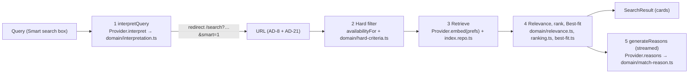
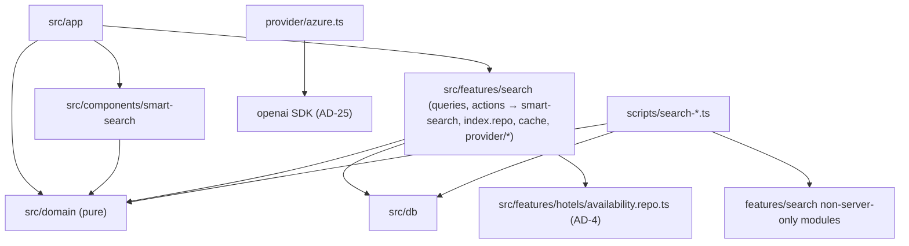
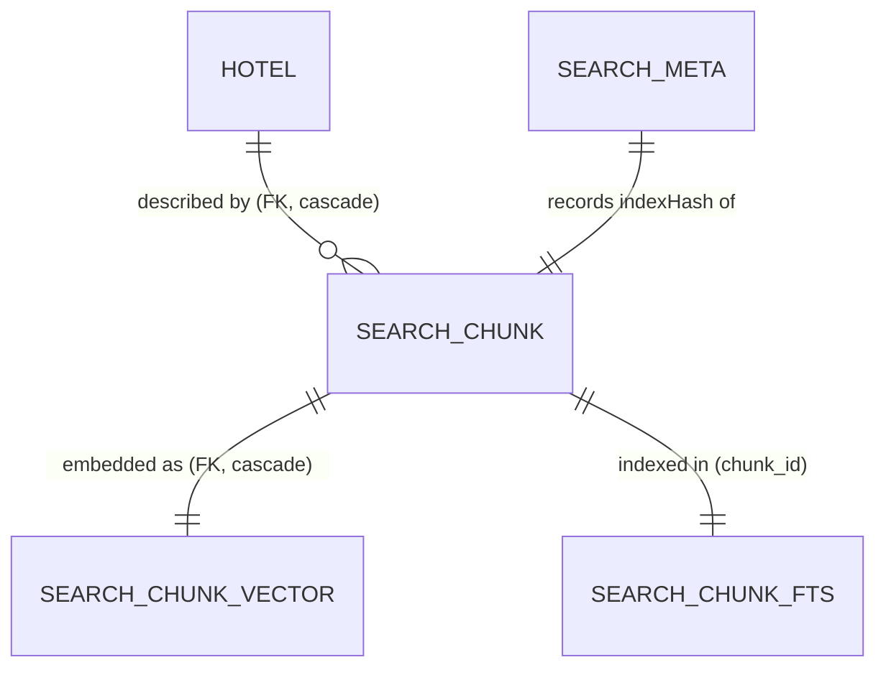
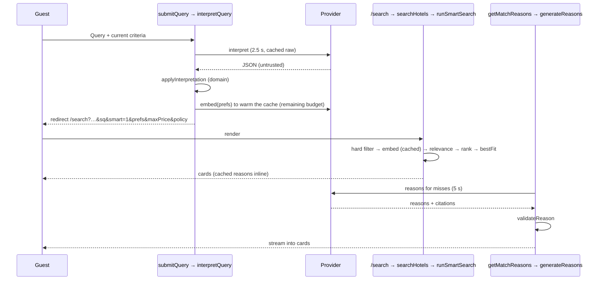
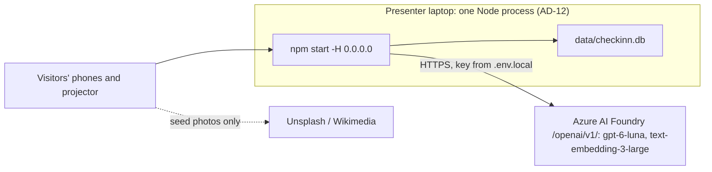

# Architecture Spine — CheckInn Smart search

This spine extends the MVP spine (`../../initiative-checkinn-mvp/architecture-checkinn/architecture-checkinn.md`). Every MVP `AD` still binds unless a row below says it is extended. New decisions continue the MVP numbering from AD-19, so an `AD` id means the same thing in both documents.

## Approvals and the build gate

These are AGENTS.md "ask first" items. The user **approved** the schema change and the `openai` SDK on 2026-10-19, so the build gate is open and the defaults below apply. The "if not approved" column is kept for the record.

| Item | Spine default if approved | If not approved | Governs |
| --- | --- | --- | --- |
| Database schema change: tables for chunks, vectors and full-text search | SQLite tables plus an FTS5 table (AD-24) | Prepared index held in memory, exact-word scoring in TypeScript (AD-24) | AD-24, AD-26 |
| The `openai` npm SDK | `openai` 7.28.0, imported only by `provider/azure.ts` (AD-25) | `fetch` against the same v1 endpoints behind the same port | AD-19, AD-25 |
| `sqlite-vec` | Not requested. Brute-force cosine in TypeScript (AD-25) | — | AD-25 |
| CI changes (`.github/workflows/`) | None needed (AD-30) | — | AD-30, AD-32 |

## Design Paradigm

**Layered, as in the MVP (AD-1).** Smart search adds no layer. Inside the search application layer it is a **pipes-and-filters pipeline**. Each stage is a pure domain function, or a repo or Provider call, with typed input and output:



| Layer (MVP AD-1) | Smart search adds |
| --- | --- |
| Presentation | Smart search box, Example queries, Criteria chips, notices, Match reason block, Best-fit chip, Score breakdown, and the `SmartSearchProvider` client context (AD-33), all in `src/components/smart-search/`; changes in `src/app/page.tsx`, `src/app/search/` and `src/app/hotels/[hotelId]/` |
| Application | `src/features/search/smart-search.ts`: the three pipeline cores `interpretQuery`, `runSmartSearch` and `generateReasons`, with no `server-only`. Also `index.repo.ts` (Prepared index reads), `provider/` (port, `azure.ts`, `fake.ts`, `config.ts`) and `cache.ts`. `actions.ts` (`submitQuery`) and `queries.ts` (`searchHotels`, `getMatchReasons`, `getSmartSearchConfig`) are thin `server-only` wrappers |
| Domain | `interpretation.ts`, `hard-criteria.ts`, `relevance.ts`, `ranking.ts`, `best-fit.ts`, `chunks.ts`, `match-reason.ts`, `golden.ts`, `text.ts`; the criteria codec and `types.ts` grow (AD-20, AD-21) |
| Data | Prepared index tables, their loader and `search_meta`, approved (AD-24) |
| Scripts | `scripts/search-index.ts`, `scripts/search-eval.ts`, `scripts/search-preflight.ts` |



## Inherited Invariants

| Inherited | From parent | Binds here |
| --- | --- | --- |
| AD-1 Layered dependency rule | MVP spine | Provider code and caches live in `src/features/search`; `src/domain` stays free of the Provider, Next, React and the database; `server-only` only in `queries.ts` and `actions.ts`. **Extended:** `scripts/search-*.ts` may import `src/domain` and the non-`server-only` modules of `src/features/search`, as the diagram above shows |
| AD-2 Request-time reads | MVP spine | In rendering, every Smart search read, Provider call and environment read happens after `await io()`. Server actions need no `io()`. Nothing that calls the Provider uses `"use cache"` |
| AD-4 Availability core | MVP spine | The Hard-criteria filter calls `availabilityFor` and adds a count ≥ Rooms rule; it never computes availability itself |
| AD-5 Ownership | MVP spine | The Prepared index is catalog-like: written only by the seed, open and reset path, never by request handling (AD-24) |
| AD-6 Seed and reset | MVP spine | `data/seed/hotel-booking-demo.json` unchanged; the reset also reloads the Prepared index and never calls the Provider (AD-24) |
| AD-7 Search seam | MVP spine | Kept and extended by AD-20 |
| AD-8 Criteria codec | MVP spine | Kept and extended by AD-21 |
| AD-9 Dates, time, money | MVP spine | Relative dates resolve against `clock.ts` today in `Africa/Johannesburg`; Max price is whole rand; Best-fit totals come from `pricing.ts`; chip copy goes through `formatZar` |
| AD-11 Action result contract | MVP spine | Applied to `submitQuery` by AD-22 |
| AD-12 One process, one SQLite file | MVP spine | In-process caches (AD-28) assume it; each e2e server gets its own file (AD-30) |
| AD-13 Client components | MVP spine | The box, chips and Search bar change state only by navigating to codec-built URLs or calling `submitQuery`; shared client state is AD-33 |
| AD-17 No network but seed photos | MVP spine | Still true for the browser. Amended for the server by AD-31 |
| AD-18 Environments | MVP spine | Extended by AD-30 |

## Invariants & Rules

### AD-19 — The Provider is a port with two adapters [ADOPTED in part]

- **Binds:** FR-2, FR-4, FR-9, FR-15, FR-16, FR-19, PRD §7, §9
- **Prevents:** Provider SDK calls scattered across pages and scripts; e2e and `npm test` reaching the network; the eval runner and the app talking to the Provider differently; Query vectors from a different model silently compared with the index.
- **Rule:**
  - `src/features/search/provider/types.ts` defines one interface: `interpret(query, context)`, `embed(texts)`, `reasons(input)` and `judge(input)`. Each takes an `AbortSignal` and either returns the parsed result or throws a `ProviderError` with a `code`: `TIMEOUT`, `RATE_LIMITED`, `UNAVAILABLE` or `INVALID_OUTPUT`.
  - `provider/azure.ts` is the only file that imports the `openai` SDK (AD-25).
    - It calls the Foundry v1 endpoint with `new OpenAI({ baseURL, apiKey })`.
    - `interpret`, `reasons` and `judge` use the Responses API, never chat completions (user decision), with strict `json_schema` output.
    - `embed` calls embeddings with `dimensions: 1024`.
    - It sets `maxRetries: 0` and `store: false` (the v1 API stores responses by default), and exposes no tools.
    - It sets `reasoning: { effort: "none" }` as the starting value and an explicit `max_output_tokens` on every Responses call. A response whose `status` is not `completed` throws `INVALID_OUTPUT`.
    - It parses JSON only from the final output message (`phase` null or `final_answer`), never from `output_text` or `responses.parse`, which at 7.28.0 can include commentary text.
    - An `APIUserAbortError` whose `signal.reason.name` is `TimeoutError` maps to `TIMEOUT`.
  - `provider/fake.ts` (AD-30) implements the same interface from committed fixtures.
  - `embed` passes every vector through `toUnitVector` (AD-26). A vector whose length differs from the Prepared index's `dimensions` throws `INVALID_OUTPUT`.
  - `provider/config.ts` `getProvider()` returns `null`, the Azure adapter or the fake adapter from the environment (AD-29). It reads the environment only at request time (AD-2) or in a script.
  - Every text sent to the Provider has passed `normaliseText` (AD-28). Guest text (the Query and Preferences) goes only in the Responses `input`, never in `instructions`.
  - Nothing outside `src/features/search` and `scripts/search-*.ts` imports `provider/`. `src/features/search/provider/imports.test.ts` scans `src/` and fails on any other import of `provider/` or `openai`; no ESLint change is needed.
  - The Provider never decides a Hard criterion, a Relevance value or an order. Its output is validated before use (AD-22, AD-27).
  - [ADOPTED] from the user: Azure AI Foundry, a `gpt-6-luna` deployment, a `text-embedding-3-large` deployment, and the Responses API. The port is this spine's decision.

### AD-20 — The search seam grows; `searchHotels` stays the one entry point

- **Binds:** FR-2, FR-3, FR-5, FR-6, FR-9–FR-14, FR-20; amends MVP AD-7 and, on purpose, PRD §8's seam wording
- **Prevents:** a second listing function for Smart search; pages that branch on Smart and MVP search themselves; two fallbacks with different filters; Match reasons holding up the list; the eval scoring different code from what guests see.
- **Rule:**
  - `searchHotels(criteria: SearchCriteria): Promise<SearchResult>` in `src/features/search/queries.ts` keeps its signature. It stays the only entry point for listing Hotels. `searchCatalog` keeps its MVP shape, and `searchHotels` adds the new fields.
  - **Types** (all in `src/domain/types.ts`):
    - `SearchCriteria` gains `smart: SmartCriteria | null` and a top-level `bestFit: string | null`.
    - `SmartCriteria` = `{ query, interpreted, preferences, maxPriceRand, policies, fallback, place, ignored }`.
    - `SearchResult` gains `mode: "mvp" | "smart" | "fallback"`, `weakMatch`, `notices: SmartNotice[]` and `criteriaSummary`. `criteriaSummary` is the no-results sentence that names the Hard criteria, built by `hardCriteriaSummary()` in `src/domain/hard-criteria.ts`.
    - `ListingCard` gains optional `bestFit: { roomTypeId, name, rooms, sleeps, nightlyRand, totalRand }` and an optional `breakdown`, which is present only under AD-29's debug flag.
    - `SmartNotice` = `{ kind: "fallback" } | { kind: "place"; place } | { kind: "ignored"; text }`. The pipeline orders notices fallback, place, ignored, and keeps at most 2.
  - **Mode**, decided in one place, `runSmartSearch`:

    | Mode | When | Filter | Order | Card |
    | --- | --- | --- | --- | --- |
    | `mvp` | `getProvider()` is null, or `smart` is null, or `smart.interpreted` is false and `smart.fallback` is false | MVP `searchCatalog`, unchanged | MVP `rank` | MVP card |
    | `smart` | `smart.interpreted` and not `smart.fallback`, and the embedding succeeded or Preferences are empty | AD-23 | `RANKING_BLEND` (AD-26) | `bestFit` always present; `nightlyRand` and `totalRand` equal the Best-fit room's |
    | `fallback` | `smart.fallback`, or the embedding failed | AD-23, with whatever Hard criteria the URL holds | MVP `rank` | MVP card, priced from the cheapest **qualifying** Room type; no `bestFit`, no reasons |

    With no Provider, every Smart search parameter is ignored and the page is the MVP page. Chips render whenever the URL holds Max price or Policy criteria, in any mode except `mvp`.
  - `weakMatch` is true only when `mode` is `smart`, there is at least one card, Preferences are not empty, and no card is a Strong match. `heading` stays the MVP count line. The page renders the Weak-match heading from `weakMatch` and `smart.query`.
  - **Cores.** `runSmartSearch(db, provider, criteria, today, now)` in `src/features/search/smart-search.ts` never throws for Provider errors; it returns `mode: "fallback"` with the fallback notice. `searchHotels` and `scripts/search-eval.ts` both call it, and the eval never re-implements a stage.
  - **Match reasons are not in `SearchResult`** (an intended deviation from PRD §8, so that they can stream, FR-15). The `/search` page calls `getMatchReasons(preferences, result)` once per render. It returns a per-Hotel map: a value for each cached reason, and a shared promise for the misses, which come from one batched call (AD-27). The page passes each card its value or the promise as a prop. Cached reasons render with the card, with no skeleton; a missed one renders inside its own `<Suspense>`. Components never import `queries.ts` (MVP AD-1).

### AD-21 — Smart search state in the URL, through the same codec

- **Binds:** FR-3, FR-4, FR-5, FR-14; EXPERIENCE Fallback URL, Stale or invalid Smart search URL, Hotel page URL; amends MVP AD-8
- **Prevents:** two parsers for Smart search parameters; a reload re-running Query interpretation; notices that vanish on reload; Smart parameters leaking onto the Hotel page and `/book`; spoofed notice text from a shared link.
- **Rule:**
  - `src/domain/criteria.ts` alone parses and serializes these new parameters, after the MVP ones and in this fixed order:

    | Param | Holds | Invalid value |
    | --- | --- | --- |
    | `sq` | The submitted Query, ≤ 300 characters. It fills the box and is required for any Smart state | Dropped; `smart` is null and every other Smart parameter is ignored |
    | `smart` | `1` = the Query was interpreted. Set only by a successful `submitQuery` | Ignored |
    | `prefs` | Preferences text, ≤ 300 characters | Dropped |
    | `maxPrice` | Max price, positive whole rand | Dropped, no chip |
    | `policy` | Comma list of `pets`, `children` and `smoking` | Unknown entries dropped |
    | `fallback` | `1` = the fallback page | Ignored without `sq` |
    | `place` | The out-of-catalog place for its notice | Dropped |
    | `ignored` | One phrase from the Query that could not be used, for its notice | Dropped |
    | `bestFit` | Hotel page only: the Best-fit Room type id | Checked against `hotel`; unknown pre-selects nothing |

  - `place` and `ignored` are at most 60 characters of letters, digits, spaces and `' - , .`, or they are dropped.
  - `smart` (the criteria field) is non-null exactly when `sq` is valid. The MVP `q` keeps its MVP meaning (the Destination), and Rooms stay in the MVP `rooms`.
  - Rendering a URL never runs Query interpretation. Only `submitQuery` (AD-22) does.
  - URL changes:
    - **Chip removal** keeps every Smart parameter except that criterion.
    - **Search bar Search** keeps `sq`, `smart` and `prefs`, and drops `fallback`, `place` and `ignored`. On a fallback URL this gives `mvp` mode with the Query still in the box, as EXPERIENCE says.
    - **Search bar Search with the box empty** (AD-33) drops every Smart parameter (FR-5).
  - `searchHref` is the only builder that writes Smart parameters. `hotelHref` writes the MVP criteria plus `bestFit`. Every `/book` and room-table URL drops `smart` and `bestFit`. A codec test asserts that `hotelHref` never contains `sq`, `smart`, `prefs`, `maxPrice`, `policy`, `fallback`, `place` or `ignored`.

### AD-22 — Query interpretation runs once, in one core, and its output is untrusted

- **Binds:** FR-1, FR-2, FR-4, FR-5, FR-17, PRD §9 Untrusted Query, Speed, Cost; applies MVP AD-11 to `submitQuery`
- **Prevents:** interpretation on page render; the Provider's raw output reaching the URL or SQL; relative dates and nicknames that differ between runs; a re-run that changes the Guest's Party; a timeout that leaves the Guest with nothing.
- **Rule:**
  - `interpretQuery(provider, query, current, catalog, today, signal)` in `smart-search.ts` is the only caller of `Provider.interpret`. `submitQuery(formData)` in `actions.ts` and `scripts/search-eval.ts` both call it.
  - **The Provider call.**
    - The Query goes only in the Responses `input`.
    - The instructions hold today's date, the City names with their aliases, and the nickname map.
    - Output is a strict `json_schema` with these fields: `destination`, `outOfCatalogPlace`, `relativeStay` (`this-weekend`, `next-weekend`, `tonight` or null), `checkIn`, `checkOut`, `stayPhrase`, `adults`, `children`, `rooms`, `partyPhrase`, `maxPrice`, `petsAllowed`, `childrenAllowed`, `smokingAllowed` and `preferences`. A `…Phrase` field is the Guest's own words for that value, used only to name an ignored value.
  - **The pure step.** `applyInterpretation(raw: unknown, current, catalog, today)` in `src/domain/interpretation.ts`:
    - validates each field against the codec's limits, and turns the first invalid one's phrase into `ignored`
    - resolves `relativeStay` with the FR-4 date rules, which win over model dates. On a Sunday, "this weekend" is Sunday to Monday (an assumption, see Open questions)
    - maps nicknames with a domain table, then checks Destination with the MVP `matches`. With no match, it fills `place` and appends the place's words to Preferences
    - keeps the current Stay when the Query states none
    - keeps the current Party, Rooms included, when the Query states neither adults nor children. When it states either, the Query's Party replaces the whole Party (children default to 0)
    - starts Destination, Max price and Policy criteria empty
    - sets Rooms to the Query's Rooms when stated. Otherwise, only when the Party came from the Query, it uses `fewestRooms` (AD-26)
  - **Timeouts.** Interpretation has 2.5 s. Right after it, `submitQuery` embeds the Preferences into the cache (AD-28) within the remaining budget, `min(1.5 s, 3 s − elapsed)`. A failure there is not an error; render retries it with 1.5 s.
  - **Outcomes** (MVP AD-11):
    - success redirects to `searchHref` with `sq`, `smart=1` and the new criteria
    - an empty Query, or one over 300 characters, returns `{ ok: false, code: "VALIDATION" }`
    - a `ProviderError` redirects to the fallback URL: the pre-submit Search bar values, `sq` and `fallback=1`, with no Max price, Policy criteria or Preferences
    - no Provider configured (a crafted POST) redirects to the MVP URL for the current criteria
    - any other error follows AD-11 `SERVER_ERROR`

    Redirects run outside any `try`, as in MVP AD-3.
  - **Cost.** The interpretation cache (AD-28) holds the Provider's raw, schema-valid output, and `applyInterpretation` runs on every submit. A new Query makes at most 3 Provider calls: interpret, embed and reasons.
  - FR-16's "never repeat instructions from the Query" is enforced by the instructions plus the injection Golden query (FR-17).

### AD-23 — Hard criteria are checked in code, before Retrieval, against one Room type

- **Binds:** FR-6, FR-10, FR-14, SM-3
- **Prevents:** a Hotel shown that breaks a Hard criterion; the filter, the Best-fit room, the Hotel page and the eval each meaning something different by "fits"; the Provider making the check.
- **Rule:**
  - `qualifyingRoomTypes(roomTypes, availability, party, maxPriceRand | null)` in `src/domain/hard-criteria.ts` is the only Hard-criteria check on Room types. A Room type qualifies when all of these hold:
    - its `availabilityFor` count ≥ `party.rooms`
    - `maxGuests × rooms` ≥ adults + children
    - `nightlyRand ≤ maxPriceRand`, when Max price is set
  - `hotelQualifies(hotel, qualifying, policies)` adds the Policy check against the seed `policies`.
  - The candidate set is the MVP Destination and Stay match (MVP `matches`, AD-4), narrowed by this check. Both `smart` and `fallback` modes apply it, following PRD FR-6. Party capacity filters in fallback too.
  - Retrieval, ranking, Best-fit and Match reasons only ever see qualifying Hotels and Room types.

### AD-24 — Enrichment and the Prepared index are committed files; the database copy is reset-owned [approved 2026-10-19]

- **Binds:** FR-7, FR-8, FR-9, PRD §9 fresh clone; extends MVP AD-5 and AD-6
- **Prevents:**
  - the app or the reset needing the Provider
  - an index that silently drifts from the seed or the Enrichment
  - an existing `data/checkinn.db` keeping an empty or stale index
  - the reset failing on FTS5 shadow tables (better-sqlite3's defensive mode makes a delete from them throw, which rolls back every `db:reset` and e2e setup)
  - tests passing on an empty index
- **Rule:**
  - **Files.**
    - `data/seed/hotel-enrichment.json` holds the Enrichment (12 Hotels, each with a description, 4 reviews and 3 highlights), keyed by seed Hotel id. The seed file is never edited.
    - `data/seed/search-index.json` (the Prepared index) holds:
      - `model`, `dimensions` and `CHUNKING_VERSION`
      - `indexHash`: the SHA-256 of the sorted chunk hashes plus model and dimensions
      - each chunk with its hash and a vector
    - Only `npm run search:index` writes it.
  - **Chunking.** `src/domain/chunks.ts` `buildChunks(seed, enrichment)` is the only chunking code. Per Hotel it produces:
    - an overview (description, category, stars and City description)
    - Facilities and house rules, written as sentences from the structured seed
    - one chunk per Room type
    - one chunk per review
    - one chunk per highlight

    Each chunk has a stable id `<hotelId>:<facet>:<n>`, `hotelId`, `roomTypeId` (Room type chunks only), `facet`, `text` and a SHA-256 `contentHash`. The module exports `CHUNKING_VERSION`.
  - **Tests in `src/domain/chunks.test.ts`.**
    - Fails with "run npm run search:index" when any chunk id, hash, `CHUNKING_VERSION`, model or dimensions differs from the committed index.
    - Fails if the Enrichment mentions a Facility or policy the Hotel lacks.
    - Fails if fewer than 4 Hotels' Enrichment never mentions quiet.
    - Fails if any description is outside 80–150 words (FR-7).
  - **Bootstrap.** The story that adds the loader also commits the Enrichment, `search-index.json` and `golden-embeddings.json`, produced by a key holder. Any later edit to the Enrichment or the chunking re-runs `search:index` in the same PR.
  - **Database copy** (approved by the user 2026-10-19). Two Drizzle migrations add these, a generated one for the plain tables and a custom one for FTS5:

    | Table | Columns |
    | --- | --- |
    | `search_chunks` | `id` text primary key; `hotel_id` FK to `hotels` with `ON DELETE CASCADE`; `room_type_id` plain nullable text, no FK; `facet`; `text`; `content_hash` |
    | `search_chunk_vectors` | `chunk_id` FK to `search_chunks` with `ON DELETE CASCADE`; `embedding` BLOB of exactly the decoded float32 bytes |
    | `search_chunks_fts` | A regular content-storing FTS5 table, `fts5(chunk_id UNINDEXED, text, tokenize='porter unicode61')`, hand-written through `drizzle-kit generate --custom`. Never external-content or contentless |
    | `search_meta` | One row holding the loaded `indexHash` |

    - `loadSearchIndex()` in `src/db/seed.ts` reads the file. `insertCatalog` loads the index in the seed and reset transaction, and `src/db` never imports `src/domain` (AD-1).
    - `openDb` also reloads only the search tables, in one transaction, when `search_meta` is missing or differs from the file's `indexHash`. So an existing database picks up a new index on the next start.
    - `resetDb` lists tables with `PRAGMA table_list` filtered to `schema = 'main'`. It deletes rows from `table` and `virtual` entries, skips `shadow` entries, and keeps excluding `sqlite_%` and `__drizzle_migrations`. A reset test runs FTS5 `integrity-check` and a `MATCH` query afterwards. The existing `reset.test.ts` passes unchanged.
    - `index.repo.ts` joins FTS hits to chunks on `chunk_id`.
  - **In-memory alternative** (if the schema change is not approved). `index.repo.ts` loads `search-index.json` once per process and scores BM25 in TypeScript. The two paths are alternatives, chosen once at the approval gate; only one is ever built. Choosing the in-memory path re-baselines `BM25_K`, `STRONG_MATCH_THRESHOLD` and the Golden-query tests on it.
  - **Test databases.** `src/db/test-db.ts` loads the real index for Retrieval and Golden-query tests, which fail if the index has fewer chunks than `buildChunks` produces.

### AD-25 — Dependencies: the `openai` SDK only, no `sqlite-vec` [approved 2026-10-19]

- **Binds:** AGENTS.md ask-first, PRD §10
- **Prevents:** a native vector extension that may not load on Windows or Node 24; Azure-specific clients; a second AI SDK.
- **Rule:**
  - `openai` 7.28.0, pinned exactly, is the one new runtime dependency. It is the newest release at least 14 days old on 2026-10-19. It was **approved by the user on 2026-10-19**, and it is imported only by `provider/azure.ts`. If it is not approved, `azure.ts` calls `POST <base>/responses` and `POST <base>/embeddings` with `fetch` behind the same port.
  - Vector similarity is a brute-force dot product over unit vectors in TypeScript, in `src/domain/relevance.ts`. `sqlite-vec` is not used and not requested. Revisit only if the index passes about 10 000 vectors.
  - No `@azure/openai`, `@azure/identity`, `dotenv`, LangChain or other AI library. Authentication is an API key.

### AD-26 — Relevance, the Ranking blend and the Best-fit room are pure domain functions and constants

- **Binds:** FR-9–FR-14, FR-20, SM-1, SM-2, SM-6, SM-C2
- **Prevents:** a relative score that changes with the candidate set; ranking and Match reasons picking different "top chunks"; weights scattered across files; the card and the Hotel page disagreeing on the Best-fit room; eval candidates leaking into the app.
- **Rule:**
  - **Vectors.** Every vector, from a file, the database or the Provider, passes through `toUnitVector(bytes | number[], dimensions)` in `relevance.ts`. It copies into a fresh `Float32Array`, checks the length and normalises. Both committed files use base64 little-endian float32.
  - **Eligible chunks** for a Hotel are its non-room chunks plus the Room type chunks of its qualifying Room types (AD-23).
  - **Per chunk**, over the whole Prepared index, so no score depends on the candidate set:
    - meaning = cosine, mapped through `MEANING_BOUNDS` (0.20 → 0, 0.60 → 1, clamped)
    - exact = the negated FTS5 `bm25`, saturated as `s / (s + BM25_K)`
    - `chunkScore = 0.75 · meaning + 0.25 · exact`
  - **Per Hotel:** `Relevance = 0.75 · max(meaning) + 0.25 · max(exact)` over its eligible chunks. `topChunks(hotel, 3)` is the 3 highest `chunkScore`, with ties broken by chunk id. A Hotel is a Strong match at `Relevance ≥ STRONG_MATCH_THRESHOLD` (0.45).
  - **Preferences.**
    - The FTS `MATCH` string is built only by `ftsQuery(preferences)`, which quotes each word token and joins them with `OR`. It returns null when no token remains, and then exact is 0.
    - Preferences are empty when `normaliseText(prefs)` is empty. Then Relevance is 0 for every Hotel, no embed or reasons call is made, and `weakMatch` is false (FR-10).
    - All these constants live in `src/domain/relevance.ts`.
  - **Ranking.** `RANKING_BLEND` in `src/domain/ranking.ts` is the single constant: the one candidate the workshop chooses (FR-12). Its starting value is Best match (0.7 / 0.15 / 0.15).
    - Fixed scales: Review score 3.0–5.0, and the Best-fit room's Nightly price R 500 → 1 and R 3 500 → 0, clamped.
    - The blend score is rounded to 4 decimals before ordering. Ties break by Review score, then the lower Best-fit Nightly price, then Hotel name.
    - The three candidates' weights exist only in `scripts/search-eval.ts`.
  - **Best-fit.** `bestFit()` in `src/domain/best-fit.ts` picks among the qualifying Room types: the highest Room-type-chunk meaning, with ties (and empty Preferences) going to the lower Nightly price. It never splits a Party. Its prices come from `src/domain/pricing.ts` (MVP AD-9).
  - **Rooms auto-raise.** `fewestRooms(party, roomTypes)` takes the Room types of Hotels matching the Destination (all Hotels when Destination is empty), ignoring Availability. It is the smallest `ceil(guests / maxGuests)`, capped by adults and the codec limit. It is used only as AD-22 says, never on a re-run.
  - **Hotel page.**
    - It pre-selects `bestFit` × the URL's `rooms` only when `sel` is absent, a Provider is configured, and `qualifyingRoomTypes` (without Max price) still includes that Room type for the page's Stay and Party.
    - When `sel` is present it wins, and `bestFit` only places the chip.
    - Otherwise nothing is pre-selected and no chip shows.
    - Changing Stay or Party on the Hotel page keeps `bestFit` and re-checks it.

### AD-27 — Match reasons are batched, cited, validated and never block

- **Binds:** FR-15, FR-16, FR-19, SM-4, PRD §9 Speed
- **Prevents:** one Provider call per card; reasons that cite another Hotel or nothing; prices or dates invented in a reason; a cached reason citing chunks that are no longer eligible; a slow reason holding up the page.
- **Rule:**
  - `generateReasons(provider, preferences, hotels, signal)` in `smart-search.ts` is the only caller of `Provider.reasons`. `getMatchReasons` and the eval both call it.
  - One call covers all the cache misses for a page. Each Hotel sends its `topChunks` with their ids. Preferences go in `input`. The output is strict JSON, `[{ hotelId, reason, citedChunkIds }]`. The instructions forbid prices, dates, availability, links and contact details.
  - `validateReason()` in `src/domain/match-reason.ts` keeps a reason only if all of these hold:
    - it is at most 120 characters
    - `citedChunkIds` is non-empty, and every id is among the chunks sent for that Hotel
    - it has no currency amount, date, URL, email or phone pattern

    Anything else is dropped, never truncated or repaired.
  - The call has a 5 s timeout. A failed, timed-out or rejected reason leaves that card with no reason.
  - No reasons are requested when Preferences are empty or the mode is not `smart`.
  - The grounding judge (FR-19) runs only in `scripts/search-eval.ts`, through `Provider.judge`. It sees only the reason and that Hotel's Search knowledge.

### AD-28 — Caches are in-process, bounded, keyed by normalised text, and share in-flight calls

- **Binds:** FR-3, FR-13, PRD §9 Cost and abuse
- **Prevents:** the same URL giving a different order; repeat or concurrent duplicate Provider calls; Next's `"use cache"` freezing Provider output; one Guest's Stay and Party leaking to another; unbounded memory on a shared stand.
- **Rule:**
  - `normaliseText` in `src/domain/text.ts` (trim, collapse whitespace, lowercase) is applied to every Provider input, cache key, fixture key and golden key.
  - `src/features/search/cache.ts` holds three bounded LRU maps (500 entries each) on `globalThis`, in one process (AD-12):
    - interpretation: the raw schema-valid output, keyed by the Query + today
    - the Preferences embedding, keyed by Preferences + `indexHash`
    - Match reasons, keyed by Preferences + Hotel id + the sorted sent chunk ids + `indexHash`
  - Each map stores the in-flight promise, so concurrent misses share one call. A rejected promise is evicted, and errors are never cached.
  - Relevance and order are recomputed from the cached embedding on every request, so they change only when Availability does. After a restart, a re-embed can move near-ties; rounding (AD-26) limits this. Nothing Provider-derived uses `"use cache"`.

### AD-29 — Configuration, secrets and the off switch

- **Binds:** FR-2, FR-20, PRD §7, §9 Secrets; extends the MVP config convention
- **Prevents:** the box showing with half a configuration; Provider config frozen into the build by prerendering; the debug breakdown reachable from a URL; secrets in the repo; a shell variable switching the Provider on in `npm test`.
- **Rule:**
  - These environment variables are read only on the server, at request time after `io()` (the Next 16 runtime environment rule) or in a script. They are never `NEXT_PUBLIC_`.

    | Variable | Meaning |
    | --- | --- |
    | `CHECKINN_PROVIDER` | `azure` (the default when the Azure variables are set), `fake`, or `off` |
    | `AZURE_OPENAI_BASE_URL` | `https://<resource>.openai.azure.com/openai/v1/` |
    | `AZURE_OPENAI_API_KEY` | The key |
    | `AZURE_OPENAI_CHAT_DEPLOYMENT` | The `gpt-6-luna` deployment name |
    | `AZURE_OPENAI_EMBEDDING_DEPLOYMENT` | The `text-embedding-3-large` deployment name |
    | `CHECKINN_SEARCH_DEBUG` | `1` shows the Score breakdown (FR-20) |

  - Smart search is configured only when `CHECKINN_PROVIDER=fake`, or when all four Azure variables are set and the provider is not `off`. Otherwise `getProvider()` is null: no box, no Example queries, Smart parameters ignored. That is the MVP app (FR-2).
  - Whether the box renders is decided by a server component inside `<Suspense>` after `io()`, and passed down as a boolean prop.
  - Values live in `.env.local` or `.env`, both gitignored. `.env.example` lists the names with no values. Scripts load `.env`, then `.env.local`, with Node's `process.loadEnvFile` when each file exists, as Next does.
  - `vitest.config.mts` sets `test.env.CHECKINN_PROVIDER = "off"`.
  - With the fake active, the server logs one warning at start. The fake is for e2e only.
  - Logs carry a `ProviderError` code and HTTP status only, never the key, the Query or Preferences.

### AD-30 — Test isolation: `npm test` and `db:reset` never call the Provider; e2e uses the fake on its own server

- **Binds:** FR-17, FR-18, PRD §9 Testable without a key; extends MVP AD-18
- **Prevents:** a test run that needs a key or network; MVP e2e specs seeing the Smart search box; Smart and MVP specs racing on one database; e2e specs that silently land on the fallback page.
- **Rule:**

  | Environment | Provider | Database |
  | --- | --- | --- |
  | Dev without `.env` | none: the MVP | `data/checkinn.db` |
  | Dev with `.env.local` | Azure | `data/checkinn.db` |
  | Unit (`npm test`) | off, or the fake injected into a core | `:memory:` |
  | E2E MVP server, port 3100 | `CHECKINN_PROVIDER=off` | its temp file |
  | E2E Smart server, port 3101 | `CHECKINN_PROVIDER=fake` | a second temp file |
  | Eval (`npm run search:eval`) | Azure | a temp file, reset to the seed |

  - **The fake.** `provider/fake.ts` answers from `data/eval/fake-provider.json` (normalised Query → interpretation, normalised Preferences → reason text) and from `data/eval/golden-embeddings.json` (Preferences → vectors).
    - Fixture interpretations use `relativeStay` or no dates, never absolute dates.
    - Fixture Preferences reuse Golden-query `expected.preferences` strings.
    - Fake reasons cite the first chunk id they were sent for each Hotel; fixtures hold no chunk ids.
    - An input the fake does not know throws `ProviderError("UNAVAILABLE")`, which the fallback specs use.
  - A Vitest test checks that every fixture Preferences string has a golden embedding, and that every fixture reason passes `validateReason`.
  - **Playwright.** `playwright.config.ts` starts both servers from one build, and `e2e/support/db.ts` gains a second path.
    - `chromium` and `mobile` ignore `smart/**`. New `smart-desktop` and `smart-mobile` projects use base URL 3101.
    - Specs in `e2e/smart/` are read-only: they stop at Reserve enabled. A Smart spec that books lives in `e2e/smart-booking/` and runs serially on 3101 after the read-only projects, with `uniqueGuestEmail()`.
    - Smart specs assert that they are not on the fallback page unless they test it.
    - Global setup resets both databases.
  - No `.github/workflows` change is needed, because CI already runs `npm run build` and then `npm run test:e2e`.
  - Retrieval and ranking Golden-query tests run in `npm test` with the committed Golden-query embeddings and no Provider (FR-18).

### AD-31 — Server-side network: only the Provider, only when configured

- **Binds:** PRD §7, §8 (the MVP §5 change), §9 Privacy; amends MVP AD-17 for the server
- **Prevents:** Smart search breaking the offline MVP; Booking or Guest data sent to the Provider; the browser calling the Provider directly.
- **Rule:**
  - The browser still loads nothing remote except seed photos (AD-17 unchanged). Provider calls are made only from the server, through AD-19.
  - With no Provider configured, the server makes no outbound request. A Vitest test stubs `globalThis.fetch` to throw, sets `CHECKINN_PROVIDER=off`, runs `runSmartSearch` and `interpretQuery`'s guard, and asserts that nothing was called. The MVP offline e2e spec stays green on 3100.
  - Only the Query, the Preferences and Hotel Search knowledge are sent. Booking, Guest and access-token data never are.

### AD-32 — Evals and Provider commands are separate npm scripts that share the pipeline

- **Binds:** FR-9, FR-17, FR-18, FR-19, PRD §7 pre-flight, §11
- **Prevents:** eval numbers from code the guest never runs; a keyed command creeping into `npm test`, `db:reset` or CI; golden answers tuned after the Enrichment; a Golden-query file every unit reads differently.
- **Rule:**

  | Command | Needs key | Does |
  | --- | --- | --- |
  | `npm run search:index` | yes | Builds chunks (`buildChunks`), embeds them and every Golden query's `expected.preferences`, and writes `data/seed/search-index.json` and `data/eval/golden-embeddings.json` with the same model and dimensions |
  | `npm run search:eval` | yes | See below |
  | `npm run search:preflight` | yes | Calls `interpret`, `embed` and `reasons` once each. Checks 1024 dimensions, that the embedding deployment's model matches the index's `model`, and that interpretation answers within 2.5 s at p95 over 5 calls; reports a quota or rate-limit error as such. Prints the deployment names (never the key) and OK, or the failing one |

  - **`search:eval`** resets a temp database and runs every Golden query through `interpretQuery`, `runSmartSearch` and `generateReasons`, using the fixed `today` from the golden file. Its report:
    - scores the §11 metrics per query and in total, with held-out queries reported separately (SM-C1)
    - scores all three Ranking blend candidates side by side
    - records the deployments, the weights and today
    - lists every *not grounded* verdict for a person to confirm
    - goes as JSON and Markdown to `.eval-results/` (added to `.gitignore`), with one line per query in the terminal

    It exits non-zero when the chosen blend misses a target, or when judge calibration fails.
  - `src/domain/golden.ts` owns the `GoldenQuery` type and parser:
    - `query`, `heldOut`, `today`
    - `expected`: Hard criteria, `preferences` written by hand, acceptable Hotels, Best-fit room and Rooms, and the Hotel that must not rank first

    `data/eval/golden-queries.json` holds the 24 Golden queries, 4 of them held out. It is committed before the Enrichment is written (FR-17).
  - The judge is calibrated against `data/eval/judge-calibration.json`, with at least 6 planted false and 6 true reasons. It must flag every false one and pass every true one before its scores count. It runs each Query 3 times.
  - None of these commands run in `npm test`, `db:reset` or CI.

### AD-33 — One client owner for Smart search UI state

- **Binds:** FR-1, FR-2, FR-5; EXPERIENCE Submitting, Re-running, Criteria chip focus, Search bar (changed)
- **Prevents:** the Search bar unable to tell that the box was cleared; five components each tracking "submitting"; chip focus and live regions lost when results re-key.
- **Rule:**
  - `SmartSearchProvider`, a client context in `src/components/smart-search/`, wraps the box, the Search bar, the chips, the notices and the listing on Home and `/search`.
    - It holds the `submitQuery` pending state, which drives read-only, `aria-disabled` and the skeletons.
    - It holds `boxIsEmpty` and the submitted Query.
    - Example queries and Try again submit through it.
  - The Search bar reads `boxIsEmpty` at Search time (AD-21). It never reads unsubmitted box text.
  - The provider sits outside the per-search `<Suspense>` and the MVP `SearchStateProvider` key, so the chip row, the results status and the "Match reasons added" live region are not re-mounted per URL.

## Consistency Conventions

| Concern | Convention |
| --- | --- |
| Terms in code | PRD Glossary: `Query`, `Preferences`, `HardCriteria`, `maxPriceRand`, `PolicyCriterion` (`pets`, `children`, `smoking`), `Relevance`, `StrongMatch`, `RankingBlend`, `BestFit`, `MatchReason`, `PreparedIndex`, `Chunk`, `Provider`, `GoldenQuery` |
| Files | kebab-case, as in the MVP; Smart search UI under `src/components/smart-search/` |
| Scores | Plain `number` in 0–1; the blend score is rounded to 4 decimals for ordering (AD-26); display rounds to two decimals in the Score breakdown |
| Vectors | `Float32Array` through `toUnitVector`; base64 little-endian float32 in files; the decoded bytes as BLOB in the database |
| Chunk ids | `<hotelId>:<facet>:<n>`, with facet one of `overview`, `facilities`, `room`, `review` or `highlight` |
| Text keys | `normaliseText` everywhere text is sent, cached or looked up (AD-28) |
| Provider errors | `ProviderError` with `code` (AD-19); every code leads to the fallback |
| Timeouts | Interpretation 2.5 s; embedding `min(1.5 s, 3 s − elapsed)` in the action and 1.5 s at render; reasons 5 s; each an `AbortSignal.timeout` |
| Guest copy | The EXPERIENCE.md voice table; never "AI" or "model" |
| Config | AD-29 variables; `CHECKINN_DB_PATH` unchanged |
| Committed data | `data/seed/hotel-enrichment.json`, `data/seed/search-index.json`, `data/eval/*.json` |
| Tests | Domain stages tested beside their files; index and Enrichment checks in `src/domain/chunks.test.ts`; import guard in `provider/imports.test.ts`; Smart flows in `e2e/smart/` and `e2e/smart-booking/` |

## Stack

Only what Smart search adds; the MVP Stack is unchanged.

| Name | Version |
| --- | --- |
| `openai` (npm), approved (AD-25) | 7.28.0 |
| SQLite FTS5, bundled in better-sqlite3 13.0.3 | SQLite 3.53.4 |
| Azure AI Foundry, OpenAI v1 API (`/openai/v1/`, no `api-version`) | v1 GA |
| Generation deployment (name to be confirmed by pre-flight) | `gpt-6-luna`, model version 2026-09-22, Global Standard |
| Embedding deployment | `text-embedding-3-large`, 1024 dimensions |

## Structural Seed

```text
data/
  seed/hotel-booking-demo.json      # unchanged (MVP AD-6)
  seed/hotel-enrichment.json        # Enrichment (AD-24)
  seed/search-index.json            # Prepared index, written by search:index (AD-24)
  eval/golden-queries.json          # 24 Golden queries, 4 held out (AD-32)
  eval/golden-embeddings.json       # their expected Preferences vectors (AD-30, AD-32)
  eval/judge-calibration.json
  eval/fake-provider.json           # fake Provider fixtures (AD-30)
drizzle/000N_search_index.sql       # approved schema change (AD-24)
scripts/search-index.ts, search-eval.ts, search-preflight.ts
src/
  domain/  interpretation.ts, hard-criteria.ts, relevance.ts, ranking.ts, best-fit.ts,
           chunks.ts, match-reason.ts, golden.ts, text.ts
  features/search/
    queries.ts        # searchHotels (AD-20), getMatchReasons, getSmartSearchConfig
    actions.ts        # submitQuery (AD-22)
    smart-search.ts   # interpretQuery, runSmartSearch, generateReasons (no server-only)
    index.repo.ts     # Prepared index reads (AD-24)
    cache.ts          # AD-28
    provider/ types.ts, config.ts, azure.ts, fake.ts, imports.test.ts
  components/smart-search/          # incl. SmartSearchProvider (AD-33)
e2e/smart/, e2e/smart-booking/
.env.example                         # names only (AD-29)
```







## Capability → Architecture Map

| Capability / Area | Lives in | Governed by |
| --- | --- | --- |
| Smart search box, Example queries, hidden without a Provider (FR-1, FR-2) | `components/smart-search`, `app/page.tsx`, `app/search` | AD-19, AD-29, AD-33, MVP AD-13 |
| URL state (FR-3) | `domain/criteria.ts` | AD-21, MVP AD-8 |
| Query interpretation (FR-4) | `smart-search.ts interpretQuery`, `actions.ts`, `domain/interpretation.ts` | AD-22, AD-26 |
| Guest corrections (FR-5) | Search bar, chips, codec, `SmartSearchProvider` | AD-21, AD-33 |
| Hard criteria and no-results naming (FR-6, FR-10) | `domain/hard-criteria.ts` | AD-20, AD-23, MVP AD-4 |
| Enrichment, Search knowledge, Prepared index (FR-7–FR-9) | `data/seed/*`, `domain/chunks.ts`, `index.repo.ts`, `src/db` | AD-24, AD-25 |
| Relevance, weak match (FR-9, FR-10) | `domain/relevance.ts` | AD-20, AD-26 |
| Ranking blend, stable order (FR-11–FR-13) | `domain/ranking.ts`, `cache.ts` | AD-26, AD-28 |
| Best-fit room and pre-selection (FR-14) | `domain/best-fit.ts`, Hotel page | AD-21, AD-26 |
| Match reasons (FR-15, FR-16) | `smart-search.ts generateReasons`, `queries.ts getMatchReasons`, `domain/match-reason.ts` | AD-20, AD-27, AD-28 |
| Golden queries, eval, judge (FR-17–FR-19) | `data/eval`, `domain/golden.ts`, `scripts/search-eval.ts` | AD-30, AD-32 |
| Score breakdown (FR-20) | Listing card | AD-26, AD-29 |
| Fallback (FR-2) | `actions.ts`, `runSmartSearch` | AD-20, AD-22, AD-23 |
| Pre-flight (PRD §7) | `scripts/search-preflight.ts` | AD-32 |

## Resolved with the user (2026-10-19)

1. **Schema change:** approved. The Prepared index goes in SQLite tables plus FTS5 (AD-24, database copy).
2. **`openai` SDK 7.28.0:** approved (AD-25).
3. **Deployments:** confirmed. `gpt-6-luna` and `text-embedding-3-large` are in the same Foundry resource and region, with GPT-6 quota available. `search:preflight` still checks all three before going on stage.
4. **Interpretation latency:** start at reasoning effort `none` with a 2.5 s timeout. If SM-5 suffers in the eval, move to effort `low` with a 4 s timeout, which puts the results target at about 4.5 s.
5. **Keys and spend:** the presenter's key only. Attendees see the MVP on a fresh clone. The deployment's tokens-per-minute quota is the spend cap, and the key is rotated after the event.
6. **"This weekend" on a Sunday:** it means tonight, Sunday to Monday for 1 night.

## Deferred

- **Exact prompt wording, schema descriptions and `max_output_tokens` values for `gpt-6-luna`.** Tuned live with the eval. The schema's field list is fixed by AD-22, and the starting reasoning effort by AD-19.
- **Tuning constants** (`MEANING_BOUNDS`, `BM25_K`, `STRONG_MATCH_THRESHOLD`, the blend weights, the cache size). These are starting values. Changing one is an ordinary edit within AD-26 and AD-28.
- **3072 against 1024 dimensions.** Can be compared with the eval. 1024 stays unless the eval shows a clear gain. A change re-runs `search:index`.
- **Running evals in CI.** Not planned. `.github/workflows` changes stay ask-first.
- **Hosting on Azure and infrastructure as code.** As in the MVP. Any host must keep AD-12 and AD-28's single-process caches, or replace them explicitly.
- **Entra ID (keyless) authentication.** The API key is enough for the workshop.
- **Rate limiting per visitor**, including crafted `prefs` URLs that each cost an embed and a reasons call. On the stand, a Provider rate limit falls back (FR-2). Revisit if the app is exposed publicly.
- **Component internals** (the "Match reasons added" announcer, focus restore) are owned by EXPERIENCE.md and the build, within AD-33.
- **Out of scope** (PRD §6.2): Smart search inside the room table, Facilities as Hard criteria, non-English Queries.
