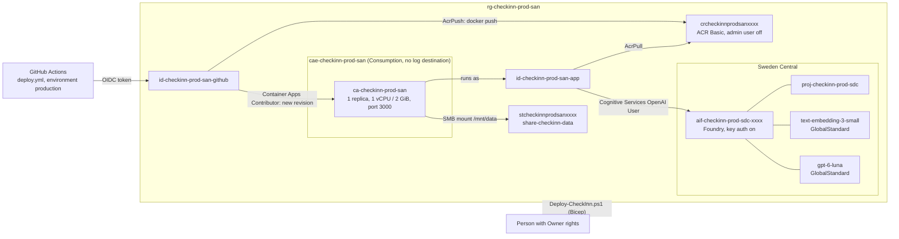

# Infrastructure

CheckInn runs as one container on Azure Container Apps in South Africa North. The SQLite database lives on an Azure Files share. A Microsoft Foundry account in Sweden Central hosts a `text-embedding-3-small` deployment for the planned natural-language search and a `gpt-6-luna` chat deployment. Bicep describes the infrastructure, a PowerShell script provisions it, and a GitHub Actions workflow builds the image and rolls out new revisions. A second, canary environment in its own resource group gets infrastructure and code from the `canary` branch (see [Canary](#canary)). No secret, key or password is stored in the repository or in GitHub.

Cost: see [azure-cost-estimate.md](azure-cost-estimate.md). Foundry embeddings and chat are billed per token only; the app does not call them yet.

## Architecture



- **One replica, one process** (AD-12). `minReplicas` and `maxReplicas` are 1 and the app is in single revision mode. The container runs `next start` directly as its only Node process, as the non-root `node` user (uid 1000).
- **Persistent database.** `CHECKINN_DB_PATH=/mnt/data/checkinn.db`, on an Azure Files share mounted with `nobrl,uid=1000,gid=1000`, so the `node` user can write it and SQLite's byte-range locks are not sent over SMB. Bookings survive restarts and new revisions. On first start the app creates the database, applies the migrations in `drizzle/` and seeds the catalog from `data/seed/`.
- **Ingress.** External, HTTPS only (`allowInsecure: false`), target port 3000.
- **No Log Analytics.** The environment has no logs destination, so there is no logging cost. Use the log stream (below) to look at a running app.
- **Foundry for search.** An `AIServices` account with project management on and local (key) auth on, one project, one `text-embedding-3-small` deployment (model version 1, GlobalStandard, 10K tokens per minute) and one `gpt-6-luna` deployment (model version 2026-09-22, GlobalStandard, 125K tokens per minute in production through `chatCapacity`, so Smart search is not rate-limited; 10K in canary). It is in Sweden Central because embedding models are not offered in South Africa North.
- **Environment variables.** `CHECKINN_DB_PATH` for the database. `AZURE_OPENAI_ENDPOINT`, `AZURE_OPENAI_CHAT_DEPLOYMENT` and `AZURE_OPENAI_EMBEDDING_DEPLOYMENT` point Smart search at Foundry, and `AZURE_OPENAI_AUTH=managed-identity` with `AZURE_CLIENT_ID` makes it sign in as the app identity, with no key. None of them is a secret. Smart search is on only when all of them are set; without them the app is the MVP search.

## Files

| File | Purpose |
|---|---|
| `main.bicep` | Subscription-scope entry point. Creates the resource group, calls the modules and outputs the values GitHub needs |
| `main.prod.bicepparam` | Production parameter values. No secrets |
| `main.canary.bicepparam` | Canary parameter values. No secrets |
| `modules/registry.bicep` | Container registry |
| `modules/storage.bicep` | Storage account and file share |
| `modules/app-identity.bicep` | The app's managed identity and its `AcrPull` role |
| `modules/container-app.bicep` | Container Apps environment, its Azure Files storage and the container app |
| `modules/foundry.bicep` | Foundry account, project, embedding and chat deployments and the app's role on the account |
| `modules/github-identity.bicep` | GitHub's managed identity, federated credential and its two roles. `main.bicep` also gives the canary identity `Contributor` and `User Access Administrator` on the subscription |
| `bicepconfig.json` | Bicep linter rules |
| `scripts/Deploy-CheckInn.ps1` | Provisions the infrastructure and prints (or sets) the GitHub variables |
| `../Dockerfile`, `../.dockerignore` | The image |
| `../.github/workflows/deploy.yml` | Builds, pushes and rolls out the image to production |
| `../.github/workflows/deploy-canary.yml` | Deploys the infrastructure, then builds, pushes and rolls out the image to canary |

## Naming

Names follow the Cloud Adoption Framework pattern `<type>-<workload>-<env>-<region>[-<suffix>]`. Registry and storage names allow letters and digits only, so they drop the hyphens. Only globally unique names get a suffix: four characters of `uniqueString(subscription, resource group)`, the same on every run.

| Resource | Abbreviation | Production name | Canary name |
|---|---|---|---|
| Resource group | `rg` | `rg-checkinn-prod-san` | `rg-checkinn-canary-san` |
| Container Apps environment | `cae` | `cae-checkinn-prod-san` | `cae-checkinn-canary-san` |
| Container app | `ca` | `ca-checkinn-prod-san` | `ca-checkinn-canary-san` |
| Container registry | `cr` | `crcheckinnprodsan<4>` | `crcheckinncanarysan<4>` |
| Storage account | `st` | `stcheckinnprodsan<4>` | `stcheckinncanarysan<4>` |
| File share | `share` | `share-checkinn-data` | `share-checkinn-data` |
| App identity | `id` | `id-checkinn-prod-san-app` | `id-checkinn-canary-san-app` |
| GitHub identity | `id` | `id-checkinn-prod-san-github` | `id-checkinn-canary-san-github` |
| Foundry account | `aif` | `aif-checkinn-prod-sdc-<4>` | `aif-checkinn-canary-sdc-<4>` |
| Foundry project | `proj` | `proj-checkinn-prod-sdc` | `proj-checkinn-canary-sdc` |

Every resource is tagged `workload`, `environment` and `managedBy: bicep`.

## One-time setup

You need the [Azure CLI](https://aka.ms/installazurecli) with Bicep, PowerShell 7, and Owner on the subscription (Contributor plus User Access Administrator also works, because the script assigns roles). The GitHub CLI is optional.

1. Sign in and preview:

   ```powershell
   az login
   ./infra/scripts/Deploy-CheckInn.ps1 -SubscriptionId <subscription-id> -WhatIf
   ```

2. Deploy:

   ```powershell
   ./infra/scripts/Deploy-CheckInn.ps1 -SubscriptionId <subscription-id>
   ```

   The first run starts the app on a public placeholder image (`mcr.microsoft.com/dotnet/samples:aspnetapp`) until the workflow ships CheckInn. Later runs read the image the app runs now and pass it back, so re-running the script never rolls the app back.

   The script prints the app URL, the Foundry endpoint and seven values: `AZURE_CLIENT_ID`, `AZURE_TENANT_ID`, `AZURE_SUBSCRIPTION_ID`, `AZURE_RESOURCE_GROUP`, `AZURE_CONTAINERAPP_NAME`, `AZURE_REGISTRY_NAME` and `AZURE_REGISTRY_LOGIN_SERVER`.

3. Put those values in GitHub as **variables** (not secrets) of the `production` environment. Either add `-ConfigureGitHub` to the command in step 2, which creates the environment and runs `gh variable set --env production` for each value, or set them by hand under **Settings > Environments > production > Environment variables**.

4. The `production` environment must allow deployments from `main` only. With `-ConfigureGitHub` the script sets this rule (custom deployment branch policies, adding `main`). It keeps policies already on the environment, so remove any others by hand. Otherwise set it by hand under **Deployment branches and tags**.

5. Run the workflow once (**Actions > Deploy > Run workflow** on `main`) to replace the placeholder.

Run `Get-Help ./infra/scripts/Deploy-CheckInn.ps1 -Full` for every parameter.

## Deploy flow

`deploy.yml` runs when the `CI` workflow succeeds for a push to `main`, or when started by hand from `main`. Runs queue one after another and never cancel each other.

1. Check out the commit CI verified.
2. Sign in to Azure with `azure/login` through OIDC.
3. Exchange that sign-in for a short-lived registry token and `docker login`. This needs only `AcrPush`.
4. `docker build` on the runner, then push `cr…azurecr.io/checkinn:<commit sha>`. The Dockerfile installs dependencies (including the Linux `better-sqlite3` binary), builds, prunes to production dependencies and copies only what `next start` needs into a slim Node 24 image.
5. `az containerapp update --image …:<sha>`, which creates a new revision. The first time, it also removes the placeholder's `ASPNETCORE_HTTP_PORTS` setting.
6. Wait until the new revision is the latest ready revision, then check that `/` returns HTTP 200. The job fails otherwise.

Pull requests and forks never deploy: the workflow only reacts to CI runs for pushes to `main` in this repository, and Azure only trusts tokens for the `production` environment.

`az acr build` would avoid Docker on the runner, but ACR Tasks needs rights `AcrPush` does not have (`scheduleRun`, `listBuildSourceUploadUrl`). Building on the runner keeps GitHub to its two roles.

## No secrets

- GitHub signs in with OpenID Connect. Azure trusts GitHub's short-lived token only when its subject is exactly `repo:Dynamic-Visual-Technologies-PTY-LTD@107921294/checkinn@1408493918:environment:production` (for the production identity) or `repo:Dynamic-Visual-Technologies-PTY-LTD@107921294/checkinn@1408493918:environment:canary` (for the canary identity). The repository uses immutable subject claims, which carry the owner and repository IDs, so a renamed or re-created repository cannot reuse the trust. `gitHubSubjectRepo` in `main.prod.bicepparam` and `main.canary.bicepparam` holds that value; check it with `gh api repos/<org>/<repo>/actions/oidc/customization/sub`.
- The client, tenant and subscription IDs and the resource names are identifiers, not credentials. They live in GitHub environment variables (`vars.*`); the workflow never uses `secrets.*`.
- The production GitHub identity holds two roles: `AcrPush` on the registry and `Container Apps Contributor` on the container app alone. It cannot change any other resource or assign roles. It never deploys Bicep. The canary GitHub identity has more; see [Canary](#canary).
- The registry's admin user is off. The app pulls with its managed identity (`AcrPull`).
- Foundry key auth is on, so its keys can be read in the portal or with `az cognitiveservices account keys list` by anyone with key-listing rights on the account. Keep them out of the repository and GitHub. The app does not use them; it will call Foundry with its managed identity (`Cognitive Services OpenAI User`).
- The file share mount needs the storage account key. Bicep reads it with `listKeys()` and passes it only to the environment's storage definition. It is never output, printed or written to a file.
- Storage: HTTPS only, TLS 1.2, no public blob access.

## Canary

A second environment, with its own resource group, registry, storage, app and Foundry account, to try infrastructure and code together before production. It uses the same Bicep with `main.canary.bicepparam`: `environment = 'canary'`, the same regions and repository, a 10K tokens-per-minute chat deployment (the `gpt-6-luna` quota is per subscription and region, so canary must fit beside production's 125K), and a GitHub identity trusted for the `canary` GitHub environment. The names are in [Naming](#naming).

### Identity rights and the accepted risk

`main.bicep` stays subscription-scoped, so the workflow that deploys it needs subscription rights. With `gitHubCanDeployInfrastructure = true` (canary only), `id-checkinn-canary-san-github` holds, besides `AcrPush` and `Container Apps Contributor`:

- `Contributor` on the subscription, to run `az deployment sub create`.
- `User Access Administrator` on the subscription, because the template assigns roles.

**Accepted risk:** these rights cover the whole subscription, production included. Anyone who can push to `canary` can change or delete production resources and grant roles. Protect the `canary` branch as carefully as `main`. Production keeps `gitHubCanDeployInfrastructure = false`, so `id-checkinn-prod-san-github` keeps only its two roles.

### One-time bootstrap

The identity the workflow signs in as is created by the Bicep deployment, so a person with Owner rights runs the first canary deployment. Do this before the `canary` branch is first pushed: the push runs `deploy-canary.yml`, whose deploy job would create an unprotected `canary` environment and then fail to sign in.

```powershell
az login
./infra/scripts/Deploy-CheckInn.ps1 -SubscriptionId <subscription-id> -ParameterFile infra/main.canary.bicepparam -ConfigureGitHub
```

The script reads `gitHubEnvironment = 'canary'` from the parameter file, deploys `rg-checkinn-canary-san` on the placeholder image, creates the `canary` GitHub environment with custom deployment branch policies, adds `canary` as an allowed branch (it keeps any policy already there; `canary` should be the only one), and sets its seven `AZURE_*` variables. The branch rule is in place before the variables. GitHub creates an environment, unprotected, the first time any workflow names it, so run the bootstrap in one go: between the Bicep deployment and the branch rule, a workflow on another branch could use the canary identity. Re-running the script leaves the rule as it is.

Then run the workflow once (**Actions > Deploy canary > Run workflow** on `canary`) to replace the placeholder.

### Deploy flow

`deploy-canary.yml` runs on every push to `canary`, or when started by hand on `canary`, in this repository only. Deploy jobs never cancel each other: one runs at a time and at most one more waits pending (a newer one replaces a pending one). The called CI does cancel: `ci.yml`'s `cancel-in-progress` applies, so when two pushes land close together the newer push cancels the older run's CI, that run's deploy never starts, and only the newer commit deploys.

1. Run `ci.yml` (lint, typecheck, test, build, end-to-end tests) as a called workflow. If any job fails, nothing deploys.
2. Sign in to Azure through OIDC as the canary GitHub identity.
3. Run `Deploy-CheckInn.ps1 -ParameterFile infra/main.canary.bicepparam`. It reads the image the app runs now and passes it back, so the infrastructure deployment keeps the old image. A failed lookup or deployment stops the job here, and the running revision keeps serving.
4. Registry token, `docker build` and push of `checkinn:<commit sha>`, `az containerapp update`, revision wait and smoke check, as in production's [deploy flow](#deploy-flow). The run links to the canary app URL.

Pull requests never deploy: the workflow has no `pull_request` trigger, and Azure only trusts tokens for the `canary` environment, which after the bootstrap only the `canary` branch may use. A push to `main` runs only `deploy.yml`.

## Risks

- **SQLite on SMB.** SQLite's documentation warns against network file systems, and WAL mode relies on shared memory that SMB does not provide across hosts. With one replica and `nobrl` this works, but a crash mid-write can still corrupt the file. Keep backups of the share (or accept a re-seed) for anything beyond a demo.
- **Revision overlap.** In single revision mode, Container Apps starts the new replica before it stops the old one. For a few seconds two processes, possibly on different hosts, have the same database file open. The share is mounted with `nobrl` and SQLite runs in WAL mode, so nothing synchronises their writes: a write in that window can be lost or can corrupt the database. Mitigation: deploy at quiet times, and back up the share (or take a share snapshot, for example `az storage share snapshot`) before each deploy so the file can be restored.
- **Container Apps Contributor scope.** It is assigned on the container app only. If Azure also checks `managedEnvironments/join/action` when a revision is updated, the first deploy fails with an authorization error on the environment; then assign the same role on `cae-checkinn-prod-san` as well.

## Operations

- **Logs.** `az containerapp logs show -g rg-checkinn-prod-san -n ca-checkinn-prod-san --follow` (needs your own sign-in).
- **Reset the data.** Scale is fixed at one replica, so: deactivate the active revision (`az containerapp revision deactivate`), delete `checkinn.db*` from `share-checkinn-data` in the portal, then activate it again. The app re-creates and re-seeds the file on its next request.
- **Canary logs.** `az containerapp logs show -g rg-checkinn-canary-san -n ca-checkinn-canary-san --follow`.
- **Change the region or environment.** Copy `main.prod.bicepparam`, change the values, and pass it with `-ParameterFile`.

## Follow-up

- The booking access cookie is still sent without `Secure` (AD-15, `src/features/booking/access.ts`). The app is now HTTPS only, so it can be marked `Secure`. That is an application change and is out of scope here.
